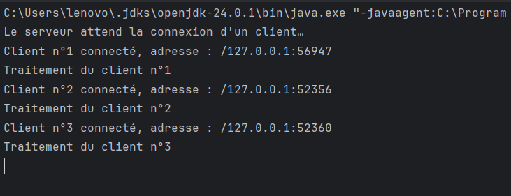
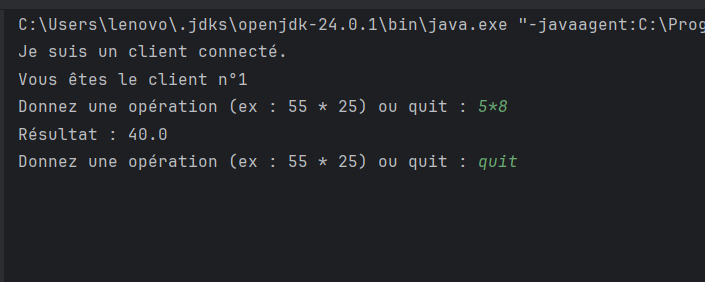
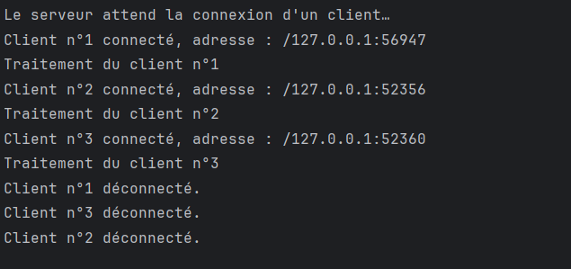

# Calculatrice client/serveur multi-threadée (Java Sockets)

Le serveur gère plusieurs clients en parallèle (un thread par client). Chaque client envoie une opération arithmétique et reçoit le résultat.

## Déroulement

1. **Serveur** (`ServerMT_3_1`) : écoute sur le port `1234` et attend un client.
2. **Connexion** : à chaque `accept()`, le serveur incrémente le numéro d'ordre, affiche l'adresse du client et lance un thread `ClientProcess_3_1`.
3. **Client** (`Client`) : se connecte à `localhost:1234` et reçoit `Vous êtes le client n°X`.
4. **Saisie** : l'utilisateur tape une opération (ex : `5*8`). La syntaxe est vérifiée avec une regex, puis le client envoie 3 lignes : opérande 1, opérateur, opérande 2.
5. **Calcul** : le thread du serveur calcule (`+ - * /`) et renvoie le résultat sur une ligne.
6. **Fin** : le client tape `quit`, le serveur affiche `Client n°X déconnecté.` et ferme la socket.

## Exécution

1. Lancer `ServerMT_3_1`.
2. Lancer `Client` une ou plusieurs fois.

## Captures d'écran

**Serveur : connexion des clients**

**Client : opération et résultat**

**Serveur : déconnexion des clients**

