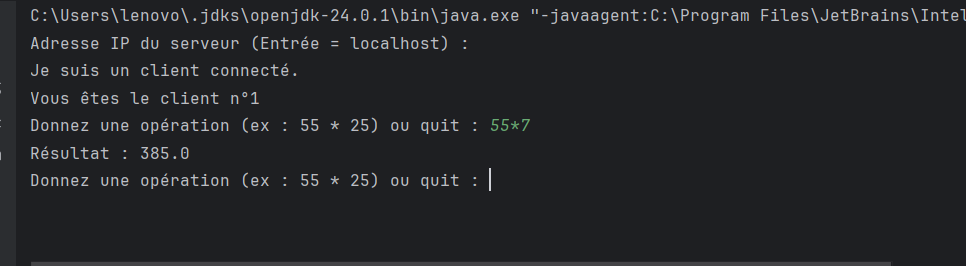
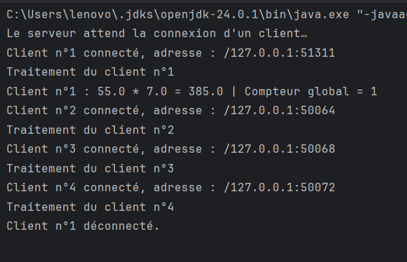

# TP3 – Activité 3-2 : Serveur multi-threads de calculatrice (Sockets TCP, communication par objets)

**Matière :** Développement d'applications réparties – LSI 3
**Auteur :** Amine

## Description

Cette activité améliore le service de calculatrice du TP2 :

- Le serveur accepte **plusieurs clients simultanément** : un thread dédié (`ClientProcess_3_2`) est créé pour chaque client.
- La communication client/serveur se fait **par objets** (`ObjectOutputStream` / `ObjectInputStream`) : le client envoie un objet `Operation`, le serveur le renvoie avec le résultat.
- Un **compteur global** partagé indique le nombre total d'opérations calculées par le serveur. Son accès est **synchronisé** pour éviter les conflits entre threads.

## Structure du projet

```
src
├── commonPackage
│   └── Operation.java          (objet sérialisable échangé)
├── clientPackage
│   └── Client_3_2.java
└── serverPackage
    ├── ServerMT_3_2.java
    └── ClientProcess_3_2.java
```

| Classe | Rôle |
|---|---|
| `Operation` | Objet `Serializable` contenant les deux opérandes, l'opérateur, le résultat et un message d'erreur éventuel. |
| `ServerMT_3_2` | Écoute sur le port **1234**, numérote chaque client et lance un thread par connexion. |
| `ClientProcess_3_2` | Thread qui reçoit les objets `Operation`, calcule, met à jour le compteur global et renvoie la réponse. |
| `Client_3_2` | Demande l'IP du serveur, valide la saisie par une regex, envoie l'objet `Operation` et affiche le résultat. |

## Déroulement

1. Le serveur démarre et attend les clients sur le port `1234`.
2. À chaque `accept()`, il incrémente le numéro d'ordre, affiche l'adresse du client et lance un thread `ClientProcess_3_2`.
3. Le client saisit l'adresse IP du serveur (Entrée = `localhost`), se connecte et reçoit `Vous êtes le client n°X`.
4. Le client saisit une opération (ex : `55*7`). Après vérification de la syntaxe, il envoie un objet `Operation`.
5. Le thread du serveur calcule (`+ - * /`), incrémente le **compteur global** de façon synchronisée, affiche sa nouvelle valeur, puis renvoie l'objet avec le résultat.
6. En cas d'erreur (division par zéro, opérateur invalide), l'erreur est renvoyée dans l'objet et le compteur n'est pas incrémenté.
7. Le client tape `quit` : le serveur affiche `Client n°X déconnecté.` et ferme la socket.

## Gestion de l'accès concurrent

Le compteur global est une variable `static` partagée par tous les threads. Sa mise à jour et son affichage sont placés dans une méthode `static synchronized` :

```java
private static synchronized void enregistrerOperation(int numeroClient, Operation op) {
    compteurGlobal++;
    System.out.println("Client n°" + numeroClient + " : " + ... + " | Compteur global = " + compteurGlobal);
}
```

Un seul thread à la fois peut exécuter cette méthode : deux clients ne peuvent donc pas lire et modifier le compteur en même temps, et les valeurs affichées restent cohérentes.

## Exécution

1. Lancer `ServerMT_3_2`.
2. Lancer `Client_3_2` une ou plusieurs fois (autoriser plusieurs instances dans IntelliJ).
3. Pour un test en réseau local, saisir l'adresse IPv4 de la machine serveur à la place de `localhost` (et autoriser le port `1234` dans le pare-feu du serveur).

## Captures d'écran

### 1. Client : connexion et calcul d'une opération

Le client reçoit son numéro (`Vous êtes le client n°1`), envoie `55*7` et reçoit le résultat `385.0`.



### 2. Serveur : clients multiples et compteur global

Le serveur gère quatre clients connectés en parallèle. Pour l'opération `55.0 * 7.0 = 385.0` du client n°1, le compteur global passe à **1**. Le client n°1 se déconnecte ensuite avec `quit`.



## Synthèse

Cette activité m'a permis de mettre en pratique un serveur **multi-threads** en Java : le thread principal ne fait qu'accepter les connexions, et chaque client est traité dans son propre thread. Le serveur reste donc disponible pendant qu'un client est en cours de traitement, et plusieurs clients sont servis en parallèle, de façon indépendante.

La communication **par objets** (`Operation` sérialisable) remplace l'envoi de trois lignes de texte du TP précédent : le code est plus clair, et le résultat comme l'erreur reviennent dans le même objet. Il faut créer l'`ObjectOutputStream` avant l'`ObjectInputStream` et utiliser `flush()` pour éviter un blocage à l'ouverture des flux.

Enfin, le **compteur global** est une ressource critique partagée par tous les threads. Sa mise à jour est protégée par une méthode `synchronized`, ce qui garantit qu'un seul thread l'incrémente à la fois et que les valeurs affichées par le serveur restent cohérentes.